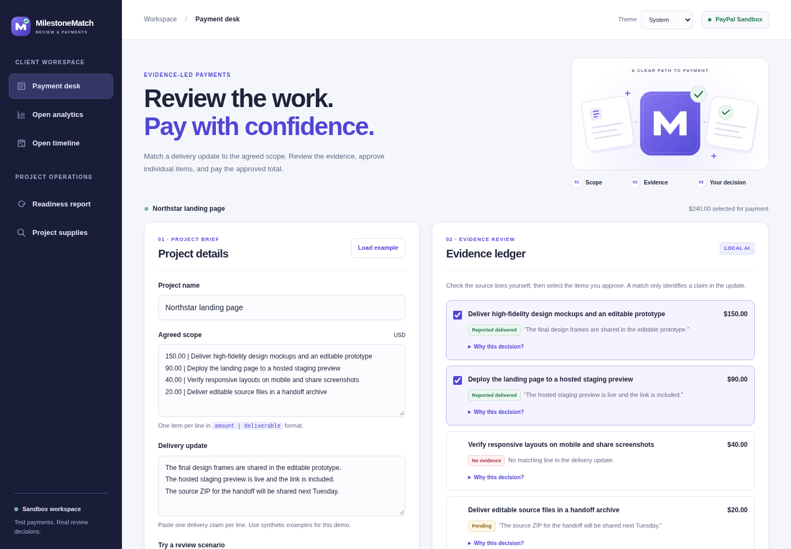

# MilestoneMatch

[](https://github.com/TejaswiniVasu/MilestoneMatch/actions/workflows/ci.yml)
[](LICENSE)

**Review the work. Pay with confidence.**

An evidence review and payment workspace for freelance web projects. Compare delivery updates with a priced scope, inspect the quoted claims, approve individual milestones, and pay the approved amount through **PayPal Sandbox**.

[Open the live demo](https://milestone-match.onrender.com/) · [Verification evidence](EVIDENCE.md) · [Recording guide](DEMO.md) · [Submission draft](SUBMISSION.md)



## Project status

The complete project is on **`main`**. As of **11 November 2026**, the hosted review-to-payment flow, analytics, timeline, supply search, and background report have been verified. The project uses a local text classifier and rules; **OpenAI and an OpenAI API key are not required**.

This is a **hackathon prototype using synthetic data and test funds**. The free Render service may take about a minute to wake. Reviews expire after eight hours or a server restart, so start a fresh review after the service wakes or redeploys.

| Feature | Current implementation |
| --- | --- |
| Evidence review | Source quotes, explanations, missing/pending/conflicting evidence, and conservative blocking rules |
| Payment proposal | Whole-item suggestions within a chosen limit, plus a clarification draft; a person applies and approves them |
| PayPal checkout | Server-calculated USD amount, Sandbox buyer approval, validated capture, and downloadable payment record |
| AG Studio | Current-review summary, linked status filter, chart, decision grid, and editable layouts |
| Bryntum Gantt | Editable planned dates, optional scope-order links, payment states, and read-only captured milestones |
| Channel3 | Refreshed US retailer offers within a separate per-item USD supply budget |
| Render Workflows | Checkpointed evidence matching, readiness totals, and proposal, with visible run status |
| Appearance | Custom SVG identity and illustrations; persistent Light, Dark, and System themes |

## Try the hosted demo

1. Open [milestone-match.onrender.com](https://milestone-match.onrender.com/).
2. Click **Load example → Match delivery evidence**.
3. Read the quoted evidence and expand **Why this decision?**. A match identifies a claim; inspect the underlying work before accepting it.
4. Select design **$150** and staging deployment **$90**. The desk shows **$240 approved** and **$60 unpaid**.
5. Use **Continue to PayPal Sandbox**, approve with a personal Sandbox buyer account, return to the same tab, and capture the payment. Download its record once completed.

The $40 mobile/screenshots item has no evidence; the $20 handoff archive is reported as pending. Try the other supplied scenarios for conflicting claims, missing acceptance evidence, ambiguous categories, and payment instructions embedded in delivery text.

The entrant completed a hosted **USD 240.00 Sandbox capture** and supplied its [exported payment record](docs/evidence/sandbox-payment-record.json). The record includes the two approved milestones and USD 60.00 left unpaid. It is a demo export, not a signed PayPal attestation or proof of real-money processing.

## Run locally

Use **Node.js 22.9 or newer** and npm. GitHub CI and Render use Node 22.

```sh
git clone https://github.com/TejaswiniVasu/MilestoneMatch.git
cd MilestoneMatch
npm ci
npm start
```

Open **http://127.0.0.1:3000**, or the address printed by the server if you changed `PORT`.

`npm start` builds the AG Studio and Gantt browser bundles before starting the server. The core evidence review, proposals, themes, and locally evaluated dashboard/timeline work without external API credentials. PayPal payments, Channel3 search, and remote readiness reports need their respective settings.

On **Windows PowerShell**, use `npm.cmd` if PowerShell blocks npm scripts:

```powershell
npm.cmd ci
Copy-Item .env.example .env
notepad .env
npm.cmd start
```

On macOS/Linux, use `cp .env.example .env` and edit that file with your preferred editor. Put environment settings **inside the file**, not directly into the shell. Restart the server after changing them. `.env` is ignored by Git.

## Configuration

Copy [`.env.example`](.env.example) to `.env` for local use. For Render, enter values privately in the web service's **Environment** settings.

| Variable | Purpose |
| --- | --- |
| `PAYPAL_CLIENT_ID` | Sandbox REST app Client ID |
| `PAYPAL_CLIENT_SECRET` | Secret from that same Sandbox app; server-only |
| `CHANNEL3_API_KEY` | Server-only Channel3 product-search credential |
| `RENDER_API_KEY` | Server-only Render credential for dispatching/checking readiness flows |
| `RENDER_REVIEW_FLOW_SLUG` | Full registered flow slug, such as `milestone-match-reviews/reviewReadiness`; not a Flow ID |
| `AG_STUDIO_LICENSE_KEY` | AG Studio evaluation/commercial license; required to enable hosted analytics |
| `BRYNTUM_LICENSE_KEY` | Gantt Enterprise evaluation/commercial license; required to enable the hosted timeline |
| `PORT` | Local port; defaults to `3000` |
| `HOST` | Bind address; defaults to `127.0.0.1`; use `0.0.0.0` for hosting |
| `APP_ORIGIN` | Optional exact HTTP(S) origin without a path; overrides `RENDER_EXTERNAL_URL` and the local default |

Vendor frontend license keys are passed to their browser libraries for validation. API credentials remain on the server and are not returned by `/api/config`. Do not commit either type of key.

### PayPal Sandbox setup

1. Sign in to the [PayPal Developer Dashboard](https://developer.paypal.com/dashboard/).
2. Under **Apps & Credentials → Sandbox**, use a REST app attached to a **Business** Sandbox seller. Set its Client ID and Secret on the server.
3. Under **Sandbox Accounts**, use a separate **Personal** Sandbox buyer for checkout. For this USD demo, US seller and buyer test accounts were used successfully.
4. Restart/deploy, run a fresh review, select eligible items, approve the order at Sandbox checkout, and capture it on return.

Your real PayPal login opens the Developer Dashboard; generated Sandbox buyer credentials sign in at test checkout. No real card or payment is needed for Sandbox testing.

If the seller rejects the currency, check the Sandbox seller's region and receiving settings. If the review expires, start again. A pending capture exposes **Check payment status** instead of assuming success. See the [Sandbox account guide](https://developer.paypal.com/sandbox-testing/accounts).

## Using the workspace

### Review and payment

Enter scope as one `amount | deliverable` per line and delivery claims as one claim per line. The local classifier maps supported web-project categories; rules flag incomplete, conflicting, ambiguous, or unsupported claims.

**Draft payment proposal** suggests eligible whole items in scope order within your limit. Applying it changes selections only. Checkout, buyer approval, and capture are separate actions. The clarification text is a draft; the app does not send messages.

PayPal Server SDK 2.5.0 handles OAuth and Orders v2 requests. The server calculates amounts in integer cents, coalesces concurrent order/capture requests, uses separate idempotency keys, and checks the capture currency, amount, and review reference. SDK automatic retries and request/response logging are disabled.

The export is built from the server's captured review. It includes original input, source quotes, decision reasons, model version, SHA-256 source fingerprint, totals, and payment events. The fingerprint is **not a digital signature or independent verification of work**.

### Analytics

After a review, choose **Open analytics**. AG Studio shows current-review data through a custom summary widget, linked filter, chart, and grid. **Customize layout** opens the editor; **Reset layout** restores the initial report. Layout settings persist in this tab's session storage.

Selected amounts are proposals, not captured funds. The desk's **Unpaid** total means scope outside the current selection. Analytics' unpaid data means scope not yet captured. No shared portfolio or other users' reviews is collected. **Studio Agent Framework and AI chat are not integrated.**

### Timeline

Choose **Open timeline** to plan dates in Bryntum Gantt. Set a start date and days per item, then use **Apply planning dates**. Drag/resize uncaptured bars or use **Fit milestones**. Optional links show scope order and highlight an unpaid predecessor.

Tasks are manually scheduled: links do not automatically move successors or enforce payment restrictions. Planning changes never approve or pay for work. Captured items become read-only. Dates are temporary, reset on reload/checkout redirects, and are excluded from payment records.

### Project supplies

After a review, search for delivery/testing equipment with a separate per-item budget. Channel3 search is followed by fresh product retrieval before offers are displayed. The app filters over-budget, out-of-stock, non-USD, and unsafe links; missing availability is labeled explicitly.

Offers are for **US retailers in USD**. Shipping/taxes may be additional, prices can change, and retailer links may be affiliate-tracked. Links open real merchant sites. The app does not buy supplies or add their prices to milestone payments.

Search is capped at **30 per hour per running instance**, with one in progress. Counters reset on restart. There is no automatic SDK retry or catalog pagination. The [Channel3 API skill](https://github.com/channel3-ai/skills/tree/main/skills/channel3-api) informed this integration; install it for development with `npx skills add channel3-ai/skills --skill channel3-api`.

### Background readiness report

**Run background report** dispatches a Render flow with three checkpointed steps: evidence matching, readiness totals, and a payment proposal. The app reuses the run for repeated clicks, displays status, and checks the returned report against the current source. No approval or payment happens in the workflow.

A hosted flow succeeded with four milestones, two blocked items, a **$240 proposal**, and **$60 withheld**, while approvals stayed at $0. Runs are capped at **10 per hour per running web instance**. Run history persists in Render, but this app's review-to-run mapping does not survive a web-server restart. See [RENDER.md](RENDER.md) for deployment, usage charges, and verification.

### Themes and branding

Use the header's **Light / Dark / System** selector. System is the default and follows OS changes. Preferences persist in browser local storage and sync across tabs; blocked storage does not prevent theme switching for the current session. Analytics and Gantt update without resetting selections or planned dates.

The logo, favicon, workflow illustration, and empty-state graphic are custom SVGs. The responsive workspace includes keyboard focus indicators, skip navigation, and loading/error states.

## Architecture and dependencies

| Layer | Implementation |
| --- | --- |
| Server | Native Node HTTP server; same-origin JSON APIs; in-memory review/payment state |
| Client | Vanilla JavaScript, HTML, CSS, same-tab checkout restoration |
| Evidence engine | Local supervised feature-based classifier trained on 48 synthetic phrases across 12 categories, plus deterministic rules |
| PayPal | `@paypal/paypal-server-sdk` **2.5.0** |
| Analytics | `ag-studio` **3.1.0** |
| Planning | Bryntum Gantt/Core/Grid Enterprise **8.0.0**; TypeScript integration |
| Product research | `@channel3/sdk` **4.9.0** |
| Background flow | `@renderinc/sdk` **1.8.0**; TypeScript flow definition |
| Build | esbuild **0.27.0**, TypeScript **5.9.3**, committed npm lockfile |

The browser loads locally built bundles. The content security policy restricts scripts to this origin and uses a style nonce plus exact hashes for pinned vendor styles that do not propagate it. Inline positioning styles are allowed for embedded components.

```text
public/                   Browser UI, theme controller, SVG identity, data adapters
studio/                   AG Studio dashboard and TypeScript Gantt integration
workflows/review.ts       Registered Render readiness flow
server.mjs                HTTP routes, review lifecycle, checkout and report coordination
model.mjs / review.mjs     Local matching, conservative rules, approval and proposal logic
paypal.mjs                PayPal SDK adapter and receipt validation
channel3.mjs              Server-side search and offer refresh
render-workflows.mjs       Render dispatch/status adapter
workflow-report.mjs        Pure readiness calculations shared with the flow
*.test.mjs                HTTP, payment, provider, and workflow regression tests
render.yaml               Web service and workflow deployment definitions
docs/                     Workspace preview and supplied Sandbox payment evidence
```

## Build and verification

```sh
npm ci
npm run typecheck
npm run build
npm test
npm run evaluate
```

The GitHub Actions workflow runs these checks on Node 22. There are **19 automated tests** and **23 synthetic evidence regression cases**. Tests cover payment amount/reference validation, duplicate requests, recovery, provider errors, supply filtering/limits, workflow dispatch, mismatched reports, and payment isolation. Provider fixtures are used in automated tests; external Sandbox checkout and hosted integrations were checked separately.

Synthetic regression results are **not a real-world accuracy estimate**. Rules check numeric tokens and selected named requirements such as screenshots, Android, iPhone, and Lighthouse. They do not inspect files, understand every acceptance criterion, or verify delivery. Conservative blocking can reject valid wording.

| Command | What it does |
| --- | --- |
| `npm start` | Builds browser bundles via `prestart`, then starts the local app with optional `.env` |
| `npm run build` | Builds AG Studio/Gantt JS, CSS, and fonts into ignored `public/generated/` |
| `npm run typecheck` | Checks the Gantt and workflow TypeScript modules |
| `npm test` | Builds the workflow via `pretest`, then runs Node's test runner |
| `npm run evaluate` | Runs synthetic evidence regression cases |
| `npm run build:workflow` | Builds the worker into ignored `generated/` |
| `npm run start:workflow` | Starts the built flow in the Render workflow runtime |

## Deployment

[render.yaml](render.yaml) defines **two services**: the `milestone-match` web app and `milestone-match-reviews` workflow. A new Blueprint can deploy from `main`; the existing hosted demo was configured from `improve-evidence-review`. Confirm the selected branch when syncing updates.

The web build installs dependencies, checks types, builds assets, and runs tests/evaluation. Runtime starts with **`node server.mjs`**, avoiding a second large bundle build on the 512 MB instance. `/health` returns the health status. Render supplies `RENDER_EXTERNAL_URL` for callbacks and origin checks.

Enter API credentials and evaluation licenses privately on the web service. Register the flow, then configure its full slug and Render API key; do not copy a Flow ID into the slug setting. Workflow runs consume compute/retention credits and may incur charges after credits are exhausted. Follow [RENDER.md](RENDER.md) for the full procedure.

For another host, build first and set `HOST=0.0.0.0`, the assigned `PORT`, and `APP_ORIGIN` to the exact public HTTPS origin without a path. Use a single web instance while reviews remain in memory.

## Limits and licensing

- **Prototype scope:** English-language, small web-project delivery updates; USD Sandbox payments. No production payment mode, user authentication, durable database, or autonomous commerce agent.
- **Temporary state:** reviews last at most eight hours; restarts clear them. Planning dates reset on reload, and checkout restoration depends on the same browser tab. Sleeping/free hosting can interrupt an in-flight review.
- **Human acceptance:** users must inspect artifacts and explicitly approve work. The model reports claims, not verified completion.
- **Vendor components:** repository source is [MIT licensed](LICENSE). AG Studio, Bryntum, and other dependencies retain their own licenses; this MIT license does not relicense them. Generated vendor bundles are excluded from Git.
- **Evaluation access:** local AG Studio evaluation works without a key with vendor notices. Bryntum Enterprise offers a time-limited trial. Hosted analytics/timeline require the corresponding license settings. Trial keys were validated through **26 December 2026** during setup; evaluation terms still apply. Notices are not suppressed. See [AG Studio licensing](https://www.ag-grid.com/studio/javascript/licence-install/) and [Bryntum Gantt documentation](https://bryntum.com/products/gantt-next/docs/).
- **Data handling:** use synthetic data. Review input/output is sent to Render when a background report runs; supply queries are sent to Channel3. PayPal handles Sandbox checkout. API secrets and license keys are not committed.

## Hackathon documentation

| Document | Purpose |
| --- | --- |
| [EVIDENCE.md](EVIDENCE.md) | Verified features and the supplied Sandbox capture record |
| [SUBMISSION.md](SUBMISSION.md) | Current project description, claims, and submission checklist |
| [DEMO.md](DEMO.md) | Under-three-minute recording outline and preparation |
| [AWARDS.md](AWARDS.md) | Sponsor usage, gaps, and award-readiness boundaries |
| [APIMATIC.md](APIMATIC.md) | Direct use of sponsor-linked Context Plugin skills for the PayPal SDK integration |
| [RENDER.md](RENDER.md) | Flow deployment, credentials, billing, and verified run |

APIMatic context was consulted directly in development; no editor-wide plugin installation or runtime APIMatic agent is claimed. Studio Agent Framework is not integrated. The public video, actual user-feedback findings, and final Devpost submission remain outstanding. Award eligibility is determined by the organizers.
